<!-- Every card on this page is drawn by scripts/profile.py. -->

  

  

  
  
  
  
  

## Agent bio

I'm a Computer Engineering student at Pandit Deendayal Energy University. I build full-stack and backend systems that hold up under load. It's the same idea as Sage: shore up the weak points before they break.

- **Barrier first.** If two people act on the same thing at once, exactly one wins: row locks, version checks and money stored in whole cents.
- **Heal the build.** At StayinFront I built a VBScript → C# converter whose compile-and-fix step cut compile errors by 95%.
- **Slow down and explain.** I co-authored an explainable-ML paper (XGBoost + SHAP) on air pollution and children's respiratory admissions, presented at ICEC2NT 2026.

## Loadout

  

  Also in the armory 
  

## Match history

<table>
  <tr>
    <td width="50%" align="center">
       
      <a href="https://github.com/ayaan-goel/kitchen-ops">code</a> · <a href="https://kitchen-ops-pied.vercel.app">live ↗</a>
    </td>
    <td width="50%" align="center">
       
      <a href="https://github.com/ayaan-goel/hrms-portal">code ↗</a>
    </td>
  </tr>
  <tr>
    <td width="50%" align="center">
       
      <a href="https://github.com/ayaan-goel/expense-management-system">code ↗</a>
    </td>
    <td width="50%" align="center">
       
      <a href="https://github.com/ayaan-goel/MINeD_24">code</a> · <a href="https://resumagic-codingrookies.streamlit.app/">live ↗</a>
    </td>
  </tr>
  <tr>
    <td width="50%" align="center">
       
      <a href="https://github.com/ayaan-goel/heritage3d">code ↗</a>
    </td>
    <td width="50%" align="center">
       
      <a href="https://github.com/ayaan-goel/ml-heart-disease">code ↗</a>
    </td>
  </tr>
</table>

## Agent contracts

- 💼 **Development Intern (R&D), StayinFront India**: VBScript → C# converter: 216 rules, 99.6% of 25,000+ lines, 350+ tests
- 🤖 **Generative AI Intern, Prodigy InfoTech**: GPT-2 fine-tuning, pix2pix GAN, neural style transfer
- 📄 **ICEC2NT 2026**: explainable-ML study of 1,110 pediatric admissions (ROC-AUC 0.775)
- 🥉 **2nd Runner-Up, Startup Weekend 2024** · JEE Advanced 2023 qualifier · IOQM qualifier ×2

## Scoreboard

  
  

  <picture>
    <source media="(prefers-color-scheme: dark)" srcset="https://raw.githubusercontent.com/ayaan-goel/ayaan-goel/output/github-contribution-grid-snake-dark.svg" />
    
  </picture>

