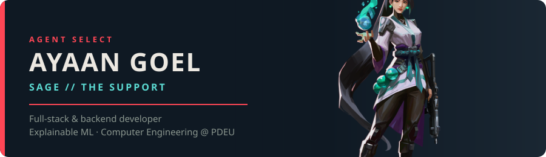
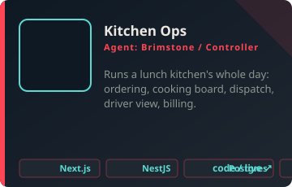
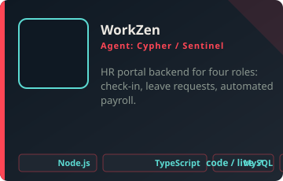
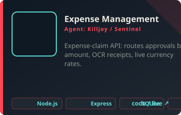
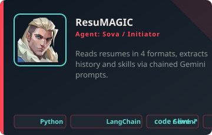
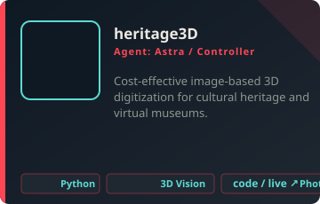
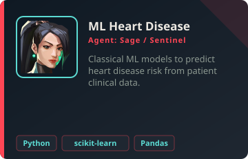

## Agent bio

Computer Engineering student at Pandit Deendayal Energy University. I build full-stack and backend systems that hold up under load — same philosophy as Sage: shore up the weak points before they break.

- 🧱 **Barrier Orb** — systems that stay correct under concurrent load
- 💚 **Healing Orb** — compile-and-fix tooling that repairs broken builds automatically
- 🐾 **Slow Orb** — explainable ML, so nothing moves without a reason

## Loadout (tech stack)

## Match history (projects)

<table>
<tr>
<td> <a href="https://github.com/ayaan-goel/kitchen-ops">code</a> · <a href="https://kitchen-ops-pied.vercel.app">live ↗</a></td>
<td> <a href="https://github.com/ayaan-goel/hrms-portal">code ↗</a></td>
</tr>
<tr>
<td> <a href="https://github.com/ayaan-goel/expense-management-system">code ↗</a></td>
<td> <a href="https://github.com/ayaan-goel/mined_24">code</a> · <a href="https://resumagic-codingrookies.streamlit.app/">live ↗</a></td>
</tr>
<tr>
<td> <a href="https://github.com/ayaan-goel/heritage3d">code ↗</a></td>
<td> <a href="https://github.com/ayaan-goel/ml-heart-disease">code ↗</a></td>
</tr>
</table>

## Agent contracts (highlights)

- 📄 Co-authored a paper on air pollution and pediatric respiratory admissions using explainable ML (XGBoost, SHAP), presented at ICEC2NT 2026
- 💼 Development Intern (R&D) at StayinFront India, Generative AI Intern at Prodigy InfoTech
- 🥉 2nd Runner-Up, Startup Weekend 2024
- 🎯 275+ problems on GeeksforGeeks (institute rank 18 of 1460), Codeforces rating 1228

## Scoreboard

<picture>
  <source media="(prefers-color-scheme: dark)" srcset="https://github-profile-summary-cards.vercel.app/api/cards/stats?username=ayaan-goel&theme=github_dark" />
  
</picture>
<picture>
  <source media="(prefers-color-scheme: dark)" srcset="https://streak-stats.demolab.com/?user=ayaan-goel&theme=github-dark-blue&hide_border=true" />
  
</picture>

<picture>
  <source media="(prefers-color-scheme: dark)" srcset="https://raw.githubusercontent.com/ayaan-goel/ayaan-goel/output/github-contribution-grid-snake-dark.svg" />
  
</picture>

